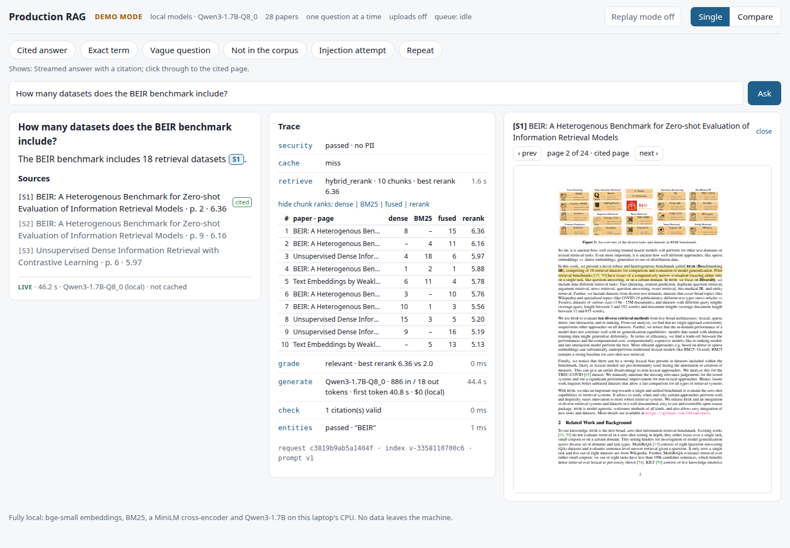
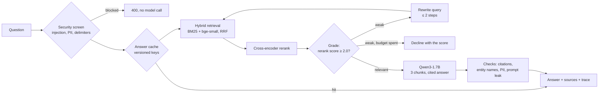
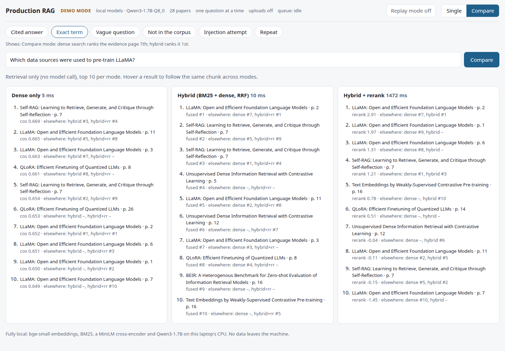
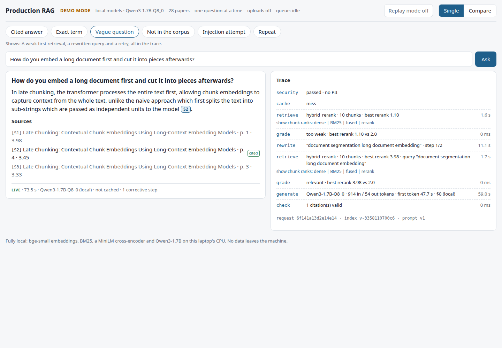
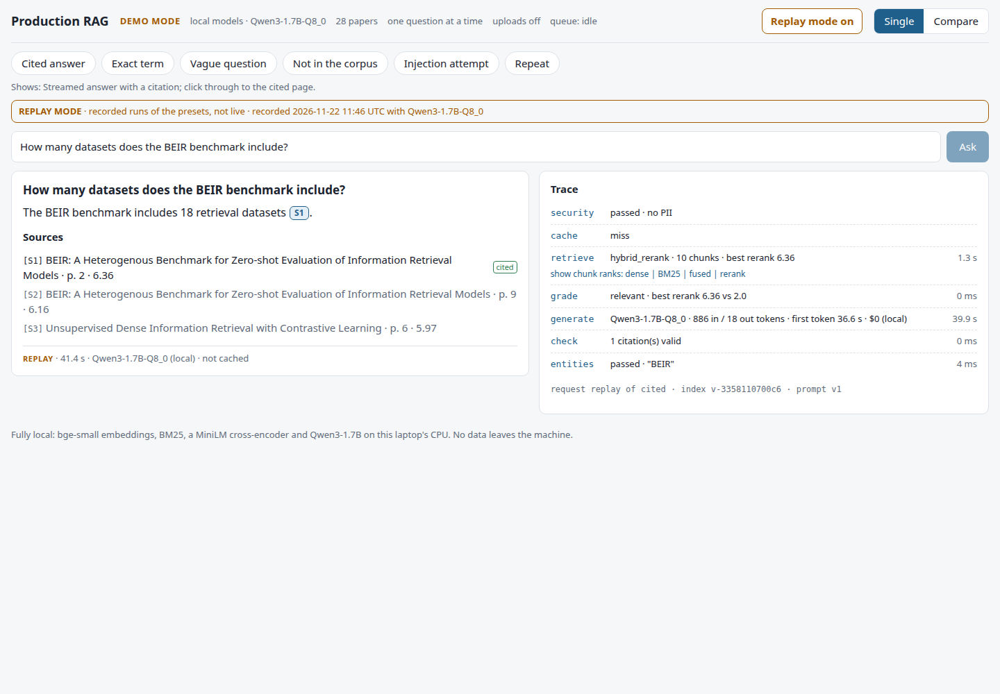

# Production RAG

Cited answers over 28 openly licensed AI/ML papers, **running entirely on a laptop
CPU**: no paid APIs, and no data leaves the machine. It answers only from the
papers, cites the page for every sentence, and declines rather than guesses.
Behind the answer sit hybrid retrieval (BM25 plus embeddings, fused with
Reciprocal Rank Fusion), a cross-encoder reranker, and a LangGraph agent that
grades the evidence and retries in bounded steps. A FastAPI service with
security layers serves it, and a web UI shows every pipeline step.



**▶ [3-minute walkthrough video](https://youtu.be/VBb8cBV-7U4)**: a live run of every preset. The waits while the CPU generates an answer are sped up 4×, and the captions say where.

## Results

| | |
|---|---|
| Golden set (30 answerable, 5 trap questions) | 27/30 answered, **100% citing an evidence page**, 4/5 traps declined |
| Held-out sets written before their experiments (12 answerable, 12 traps) | 10/12 answered, **12/12 traps declined** |
| Retrieval: evidence page in the top 3 (golden set) | dense 73% → hybrid + rerank **97%** |
| Public benchmark: BEIR SciFact nDCG@10 | dense 0.707, hybrid + rerank 0.687 (published BM25 + same reranker: 0.688) |
| Latency on a 4-core laptop CPU | retrieval and trace in **~2 s**, answer in ~35–65 s, cache hit in ms |
| API exit gate (curl scenarios against the real service) | 21/21, and 14/14 in demo mode |
| UI exit gate (headless Chrome, real models, through a Cloudflare tunnel) | 23/23 checks, every preset |

The traps are the interesting part. Each one asks about a model the corpus
doesn't cover, while the corpus holds a similar fact about a nearby model. One
asks how many GPUs trained Llama 2; the LLaMA (v1) paper states its own 2,048
A100s. Every experiment, including the failed ones, is recorded with criteria
set before it ran (see the Phase 3 and Phase 4 sections).

## How it works



Every step records what it did into a trace. The trace is streamed to the UI
as server-sent events, so the retrieval scores appear about 30 seconds before
the answer finishes. The LLM sits behind a gateway that switches to
Qwen3-0.6B if the main model hasn't produced a first token within 90 s.

| Part | Choice |
|---|---|
| Embeddings | `BAAI/bge-small-en-v1.5`, quantized ONNX via fastembed (no PyTorch) |
| Index | Chroma on disk, versioned by embedding model and chunking settings |
| Keyword search | BM25 (rank-bm25) |
| Reranker | `ms-marco-MiniLM-L-6-v2` (ONNX) |
| LLM | Qwen3-1.7B Q8_0 via llama.cpp, Qwen3-0.6B fallback |
| Agent | LangGraph state machine, bounded retries |
| Service | FastAPI, SSE streaming, own rate limiter and cache |
| UI | React, Vite, TypeScript, PDF.js |

## Quick start (clean clone)

Needs Python 3.12+, [uv](https://docs.astral.sh/uv/), Node 22, about 3 GB of
disk for the models, and a few GB of RAM (Qwen3-1.7B uses about 2.4 GB).

```bash
git clone <this repo> productionRAG && cd productionRAG
uv sync --locked
cp .env.example .env              # optional: RAG_MODELS_DIR, HF_TOKEN
uv run rag models download        # Qwen3 1.7B + 0.6B GGUF (2.5 GB), SHA-256 checked
uv run rag corpus download        # the 28 redistributable PDFs from arXiv, hash-pinned
uv run rag ingest                 # chunk, embed, index (~14 min on a 4-core CPU)
(cd frontend && npm ci && npm run build)
deploy/local-demo/demo.sh start   # waits until the model is loaded
```

Open http://127.0.0.1:8000. `demo.sh status` and `demo.sh stop` manage the
server. Model files go to `RAG_MODELS_DIR` (default `.cache/models`), so
several projects can share one copy.

## Running the demo

- **Start:** `deploy/local-demo/demo.sh start` binds to 127.0.0.1 only, in
  demo mode: uploads, deletes and API docs off, and questions limited to 500
  characters.
- **Pre-warm (optional):** `demo.sh warm` answers the preset questions once, so
  they're served from the cache. The UI labels them "cached", never "live".
- **Share:** `cloudflared tunnel --no-autoupdate --url http://127.0.0.1:8000`
  gives a temporary `https://….trycloudflare.com` link. The server reads the
  real client IP from Cloudflare's header for rate limiting. Stop the tunnel
  after the interview.
- **Fallbacks:**
  - If the tunnel is blocked, share your screen and use the local URL.
  - If the model is too slow or fails, use **Replay mode** in the UI. It plays
    real recorded runs of the presets step by step, labelled REPLAY, and works
    even while the model is still loading. Record them with
    `uv run rag demo record`, against a freshly started service. Re-record
    after re-indexing; stale replays are flagged.
  - If everything fails, use the [walkthrough video](https://youtu.be/VBb8cBV-7U4). To re-record it:
    `(cd frontend && node e2e/walkthrough.mjs)` records a captioned live run of
    every preset, and `uv run --with imageio-ffmpeg python scripts/make_video.py`
    speeds up only the CPU-generation waits, with a caption saying so.
- **Docker:** `docker compose up --build` builds the UI and the service into one
  image (non-root, HEALTHCHECK on `/health`), with the models, index and PDFs
  mounted. **Not yet verified:** Docker isn't installed on the development
  laptop, so the image has never been built. Use `demo.sh` until it has.

## Limitations

- **Slow by design:** about 35–65 s per answer on the CPU, one answer at a time.
  A second question waits, and a third gets "busy, try again in a minute". The
  UI shows retrieval within 2 s so the wait is visible, not silent.
- **Wrong-entity answers:** the 1.7B model can credit a fact about a nearby
  model to the one asked about. One golden trap is still answered this way: it
  gives RETRO's dropout rate as the original Transformer's. An entity-name check
  catches the cases with a specific name (it caught the Llama 2 one), not
  generic names like "Transformer".
- **Over-refusals:** 3 of 30 golden questions are declined. One is a retrieval
  miss, one the model declines although the evidence is in its context, and one
  is withdrawn by the entity check because the passage never says "E5".
- **Query rewrites rarely help:** they rescued 1 of 6 vague held-out questions.
- **Small evaluation sets:** 30 + 5, 5 + 5 and 7 + 7 questions. A difference of
  one or two questions is noise, which is why changes are validated on
  held-out sets written before they run.
- **Keyword checks over-credit:** an answer giving DINO's batch size as 128 (an
  ablation setting) passed because "1024" appeared later in the same answer.
- **Regex security is one layer:** it catches common prompt injections
  instantly but not determined attackers. The model also has no tools, the
  prompt treats sources as data, and answers must cite them.
- **Corpus:** only papers whose licence allows redistribution (28 of 78
  candidates). Many famous papers use arXiv's default licence and aren't
  included.

> **Status:** all seven phases are built and their exit gates passed, including
> a rehearsal through the tunnel from a phone on mobile data (2026-11-22). The
> Docker image hasn't been built yet.

## Capability status

| Capability | Status |
|---|---|
| Repository setup: secrets excluded, locked dependencies, lint and tests in CI | IMPLEMENTED |
| Corpus: licence check against arXiv metadata, manifest, hash-pinned downloads | IMPLEMENTED |
| Ingestion with page metadata, content-based IDs, duplicate detection | IMPLEMENTED |
| Page-scoped chunking, cached embeddings, versioned Chroma index | IMPLEMENTED |
| Dense search from the command line (local bge-small embeddings) | IMPLEMENTED |
| Known-phrase check of the index (`rag eval phrases`) | IMPLEMENTED |
| Baseline RAG: cited answers from Qwen3-1.7B, abstention, pipeline trace (`rag ask`) | IMPLEMENTED |
| Golden question set and evaluation harness (`rag eval golden`) | IMPLEMENTED |
| Hybrid retrieval (BM25 + dense, RRF) and cross-encoder reranking | IMPLEMENTED |
| BEIR SciFact benchmark (`rag eval beir`) | IMPLEMENTED |
| LangGraph correction loop with bounded retries and model fallback | IMPLEMENTED |
| Entity check: names in the question must appear in a cited source | IMPLEMENTED |
| Held-out question set for changes chosen after seeing results | IMPLEMENTED |
| FastAPI service: security, caching, rate limits, streaming, observability | IMPLEMENTED |
| Demo UI: chat, citation viewer, trace panel, compare mode | IMPLEMENTED |
| Local demo: Docker, start script, Cloudflare tunnel | PLANNED |

## Corpus

The demo corpus is a set of AI/ML papers from arXiv. Each paper's licence is
read from arXiv's metadata, and only papers whose licence allows redistribution
(Creative Commons) are downloaded and served: currently 28 of 78 candidates.
Many well-known papers use arXiv's default licence, which allows only arXiv to
distribute them, so they are not included.

```bash
uv run rag corpus check      # look up licences, write corpus/manifest.yaml
uv run rag corpus download   # fetch redistributable PDFs, pin their SHA-256
uv run rag ingest            # chunk, embed and index them locally (~14 min on a 4-core CPU)
uv run rag search "How does ColBERTv2 reduce the storage cost of late interaction?"
uv run rag eval phrases      # sanity check: do sampled sentences find their own page?
```

Current index: 28 papers, 2,829 chunks (2,835 before the Phase 4 text repair). Baseline dense-only results are in
the table below. They come from the known-phrase check: 200 sentences sampled
from the index (seed 7), each used as a query.

| Sentences | n | Right page at rank 1 | Right page in top 5 | Right paper at rank 1 |
|---|---|---|---|---|
| Prose | 164 | 54% | 70% | 74% |
| Reference-list entries | 36 | 19% | 39% | 33% |

Dense embeddings capture meaning rather than exact names and titles, so
reference-list entries do poorly. With hybrid search and reranking (the default
since Phase 3) the same check gives 87% / 96% for prose and 72% / 89% for
reference entries.

## Asking questions

```bash
uv run rag ask "How does ColBERTv2 reduce the storage cost of late interaction?" --trace
```

The answer streams from Qwen3-1.7B on the CPU, with a `[S#]` tag after each
sentence pointing to a paper and page. `--trace` shows each step: retrieved
chunks and scores, the relevance check, generation timings, and the citation
check. If nothing relevant is retrieved, or the model finds no answer in the
sources, it declines instead of guessing.

## Baseline evaluation (dense retrieval)

`eval/golden.yaml` has 30 answerable questions across 24 papers and 5 that must
be declined. Several of those are traps: the corpus contains a similar-looking
fact, such as RETRO's dropout rate, that must not be given as the answer. Each
answerable question's evidence pages are found by searching the paper's text
for evidence phrases, not by the retriever. Results from
`eval/results/2026-11-20_baseline-dense-v2.json`:

| Metric | Baseline |
|---|---|
| Evidence page in top 3 / top 10 retrieved | 70% / 90% |
| Right paper ranked first | 87% |
| Unanswerable questions declined (all traps) | **5 / 5** |
| Answerable questions answered | 87% |
| Answers with citations (none invented, none inferred) | 100% |
| Answers citing an evidence page | 73% |
| Expected keywords present in answers | 0.75 |
| Median time per question (4-core laptop CPU) | 36 s |

Most failures are **retrieval misses**: the evidence page wasn't among the 3
chunks given to the model. In two of those cases the model combined unrelated
passages into a wrong answer instead of declining. Hybrid search, reranking and
an evidence-grading step are the planned fixes.

## Retrieval quality (Phase 3)

The default retriever is now **hybrid + rerank**: BM25 and dense search fused
with Reciprocal Rank Fusion, then the top 20 rescored by a cross-encoder
(ms-marco-MiniLM-L-6-v2, ONNX on the CPU). Every candidate keeps its rank from
each stage, so `rag search` and `rag ask --trace` show why a chunk ranks where it
does. Golden set, v2 evidence labels (every page that states the answer):

| Retrieval mode | Evidence page at rank 1 | in top 3 | MRR | Right paper first |
|---|---|---|---|---|
| dense (Phase 2) | 60% | 73% | 0.704 | 87% |
| BM25 | 67% | 87% | 0.780 | 90% |
| hybrid (RRF) | 70% | 90% | 0.808 | 97% |
| dense + rerank | 80% | 97% | 0.890 | 97% |
| **hybrid + rerank** | **80%** | **100%** | **0.900** | **97%** |

Answers with hybrid + rerank (`eval/results/2026-11-20_p3-hybrid_rerank.json`):

| Metric | Phase 2 dense | Phase 3 hybrid + rerank |
|---|---|---|
| Unanswerable questions declined | 5 / 5 | 5 / 5 (3 by the relevance gate, before the LLM) |
| Answerable questions answered | 87% | 93% |
| Answers citing an evidence page (v2 labels) | 73% | **96%** |
| Expected keywords present | 0.75 | 0.90 |
| Wrong answers built from unrelated passages | 2 | 0 |

The relevance gate now uses the reranker score (threshold 2.0), which reads the
question and passage together and separates off-topic questions far better than
cosine similarity. The two remaining failures are refusals with the evidence in
hand, a generation problem left for the Phase 4 agent loop.

**Public benchmark, BEIR SciFact** (300 queries, 5,183 abstracts):

| Mode | nDCG@10 | Recall@100 | Published (BEIR paper, Table 2) |
|---|---|---|---|
| BM25 (no stemming) | 0.647 | 0.866 | BM25 0.665 |
| dense (bge-small, quantized) | **0.707** | 0.943 | |
| hybrid | 0.688 | **0.965** | |
| hybrid + rerank | 0.687 | 0.965 | BM25 + same cross-encoder 0.688 |

On SciFact, dense alone wins and the web-search-trained reranker adds nothing
(at 15 s/query for 100 candidates). On this project's papers, hybrid + rerank
wins clearly. The best configuration depends on the data, which is why both
benchmarks are run.

**Experiments recorded:** relabelled golden set (v1 single-phrase labels
understated answer quality: 82% vs 96% citing evidence, while the Phase 2
baseline scores 73% under both); a query-time bibliography filter (accurate,
but bibliography chunks almost never reach the top 3 once hybrid + rerank is
used, so it is off by default: `RAG_SKIP_REFERENCES=1`). `rag eval rescore`
re-scores saved answer runs against either label set without rerunning the LLM.

## Agent loop (Phase 4)

`rag ask` runs a LangGraph agent (`--pipeline single` runs the one-pass
pipeline, kept for comparison):

```
retrieve -> grade --relevant--> generate -> check -> answer or decline
              |
              +--too weak--> rewrite the query (LLM) -> retrieve again
```

- **Grade** uses the reranker score (threshold 2.0), not an LLM call: a 1.7B
  grader on a CPU would be slow and unreliable.
- **Rewrite**: when the evidence is weak, a short LLM call turns the question
  into a search query and retrieval runs again. At most 2 corrective steps per
  question; each one is a trace step with its budget. **It rarely rescues a
  question.** On 6 vague held-out questions that failed the gate, the rewrite
  rescued 1. The first version rescued 2, but only by luck: a prompt bug made
  it produce slash-style junk ("/search_billion_vectors_quickly"). The likely
  limit is that the cross-encoder, trained on natural questions, scores keyword
  queries lower. Traps stayed declined with both versions (16/17).
- **Fallback**: if Qwen3-1.7B produces no first token within 90 s (normally
  35–47 s on this laptop) or fails, Qwen3-0.6B answers and the trace says why.
  The timeout really interrupts llama.cpp mid-prompt, through its abort callback.

**What didn't work, and is off by default.** A "focus" retry, for when the model
declines although good evidence was retrieved, gives it the best sentences of
the top 10 passages instead of 3 whole chunks. It recovered one over-refusal but
made the model answer two trap questions with a fact about a *similar* model:

| Trap question | Wrong answer after the retry | Where the fact came from |
|---|---|---|
| What dropout rate did the original Transformer base model use? | 0.1 | DETR's transformer |
| How many GPUs were used to train Llama 2? | 2048 A100s | the first LLaMA paper |

Requiring the focused sentences to pass the reranker gate fixed the first case,
but that rule was chosen after seeing the result. On held-out questions written
beforehand it failed: the reranker scored those near-miss sentences 4–5, far
above the gate. A relevance score measures topic, not identity. The retry
stays available (`RAG_FOCUS_RETRY=true`) to reproduce the experiments.

**Entity check (on by default).** After the model answers, every name in the
question ("Llama 2", "Mixtral 8x22B", "Sentence-BERT") must appear in the text or
paper title of at least one cited source, or the answer is withdrawn and the
system declines. Matching is whole-word, so "LLaMA, 2048 A100 GPUs" does not count
as "Llama 2". No LLM call; the trace keeps the withdrawn answer.

It was tested on a second held-out set written before the code (7 answerable
questions that each name a model, 7 traps):

- With the focus retry on, it **caught the Llama 2 answer above**: the retry
  produced "LLaMA 2 involves 2048 A100 GPUs" again, and the check withdrew it.
- In the default pipeline it **withdrew no wrong answer** across the three
  question sets (the model declined the traps by itself) and **withdrew one
  correct answer**: the cited E5 passage never says "E5", and neither does the
  paper's title. Short-name aliases per paper would fix that.
- It can't catch generic names. "The original Transformer" is satisfied by any
  passage that says "transformer", so the golden trap u01 is still answered.

With the check on, the focus retry passed the criteria set for it, but it stays
off. Its only correct new answer was on a question seen during development. On
the new held-out set, its two new answers didn't answer the question ("…is
initialized with a pre-trained LM"). For a portfolio demo, declining beats a
non-answer.

**Current results** (default: agent with rewrites, fallback and entity check;
focus off):

| | Golden set (30 + 5 traps) | Held-out 1 (5 + 5) | Held-out 2 (7 + 7) |
|---|---|---|---|
| Answerable questions answered | 27 / 30 | 5 / 5 | 5 / 7 |
| Trap questions declined | 4 / 5 | 5 / 5 | 7 / 7 |
| Answers citing an evidence page | 100% | 80% | 80% |
| Median seconds per question | 35.8 | 38.0 | 46.5 |

Held-out 2's two declines are a retrieval miss (Self-RAG's generator is named on
pages that weren't retrieved) and an over-refusal (LLaMA's "2048 A100 GPU"
sentence was the first source). One held-out 2 answer is wrong although its
keyword matched: DINO's batch size is given as 128, an ablation setting, instead
of the default 1024.

The golden-set trap now missed (u01) appeared after a text-extraction fix: the
RETRO paper's small-caps name ("R/e.sc /t.sc /r.sc/o.sc") is now repaired, which
made its hyperparameter table readable, and the model attributes RETRO's dropout
rate to the original Transformer. The fix stays: it is correct, and the earlier
5/5 relied partly on garbled text. Attributing facts to the wrong model is the
main open weakness; the entity check above catches only the cases with a specific name.

## API service (Phase 5)

```bash
uv run rag serve              # http://127.0.0.1:8000, API docs at /docs
uv run rag serve --demo       # demo mode, for sharing through a tunnel
scripts/curl_scenarios.sh     # the exit-gate scenarios against a running service
```

| Endpoint | Purpose |
|---|---|
| `POST /v1/query` | Answer with sources, citations, the trace, `cached`, `latency_ms`, `request_id` |
| `POST /v1/query/stream` | Server-sent events: each trace step as it finishes, answer tokens, then the checked final answer |
| `POST /v1/compare` | One question through several retrieval modes (retrieval only, no LLM) |
| `GET /v1/documents`, `GET /v1/documents/{id}/file` | Indexed papers; the PDF for the citation viewer, only if its licence allows redistribution |
| `POST /v1/documents`, `DELETE /v1/documents/{id}` | Upload (PDF checks, 409 on duplicates) and delete; off in demo mode |
| `GET /v1/demo/presets` | Preset demo questions |
| `GET /health`, `GET /ready` | Liveness; readiness (503 until the index, reranker and model are loaded) |
| `GET /metrics` | Requests, error rate, p50/p95 latency, cache hit rate, abstention rate, tokens |

**Layers, outermost first.**

1. **Request ID and JSON logs.** Every log line carries the request ID; client IPs are logged as hashes.
2. **Rate limits per client.** Questions and other requests have separate limits, with a 429 and `Retry-After` when exceeded. Behind the Cloudflare tunnel every request arrives from 127.0.0.1, so the client IP is read from `CF-Connecting-IP`, but only when the connection comes from this machine.
3. **Input screen.** It strips chat-template delimiters (`<|im_start|>`, `[INST]`), blocks common injection phrases before any model call, and masks PII (emails, phones, cards with a Luhn check, SSN, Aadhaar with its checksum, PAN, UK NI numbers).
4. **Cache.** An exact-match cache whose key includes the index version, the corpus revision, the prompt version and the answer settings, so re-indexing or uploading invalidates old answers. Answers from the fallback model aren't cached, so they're retried live next time.
5. **Generation gate.** One answer at a time, since the CPU can't run two. One more question may wait; beyond that the reply is 503 "busy" with `Retry-After`.
6. **Output checks.** PII the model repeats is masked, including in the token stream, where text is held back briefly so a split email is masked before any of it is sent. An answer that repeats the system prompt is withheld.

Errors share one shape, `{"error", "detail", "request_id"}`, and never include a stack trace, a host path or the input. Writes need `RAG_ADMIN_TOKEN` when it's set, or a request from this machine.

**Demo mode** (`--demo` or `RAG_DEMO_MODE=true`) turns off uploads, deletes and the API docs, and limits questions to 500 characters.

**Regex limits.** The input screen catches common attacks without an LLM call, but a determined attacker can get past it. It's one layer: the model has no tools that can do damage, the prompt treats sources as data, and answers must cite them. Masking rules were tested against research text, because tables like "2048 1024 4096" look like ID numbers. Snippets from the published papers aren't masked.

**Exit gate.** `scripts/curl_scenarios.sh` passes against the real service with Qwen3-1.7B: 21/21 scenarios normally and 14/14 in demo mode (2026-11-22). Highlights:

- A cited answer in 33.9 s.
- The same question as a cache hit in milliseconds.
- A queued question answered after the running one.
- A third concurrent question refused with "busy" at once.
- Trace steps streamed before the first token.
- 429 after the per-minute limit.

The run also found a bug the unit tests had missed. The refusal sentence is part of the system prompt, so the leak check relabelled model refusals as "the answer repeated the system prompt". It's fixed, with a regression test.

## Demo UI (Phase 6)

```bash
cd frontend && npm ci && npm run build && cd ..
uv run rag serve --demo          # UI and API on http://127.0.0.1:8000
cd frontend && npm run dev       # development: Vite on :5173, API proxied to :8000
```

A React app (Vite, TypeScript) served by FastAPI from the same origin, so there's
no CORS to configure and one URL works through the tunnel.

- **Chat:** answers stream token by token over `POST /v1/query/stream`. The
  checked final answer then replaces the raw tokens: the citation check, entity
  check and output masks have run on it.
- **Citation chips:** each `[S#]` opens the cited page in a PDF.js viewer, with
  the passage highlighted. Matching compares letters and digits only, so it
  copes with PDF hyphenation and spacing.
- **Trace panel:** each step lights up as it finishes (security, cache,
  retrieve, grade, rewrite, generate, check, entities), with scores, tokens and
  timings, plus an expandable table of each chunk's dense, BM25, fused and
  rerank ranks. Retrieval shows up in about 2 s, long before the answer (about
  35 s on the CPU).
- **Compare mode:** dense, hybrid, and hybrid with reranking side by side, top
  10 each. Retrieval only, so it takes about 1.5 s.
- **Presets and banner:** one button per capability. The banner shows demo
  mode, the model and the queue. Each result is labelled **live**, **cached**
  or (in Phase 7) **replay**, never one passed off as another.

**Exit gate (2026-11-22).** `npm run e2e` drives the installed Chrome
headlessly against the real service in demo mode and checks every preset:
**18/18 checks pass**, with no console errors.

| Preset | What the browser check confirmed |
|---|---|
| Cited answer | "18 retrieval datasets [S1]" in 37 s; the chip opens BEIR p. 2 with the passage highlighted |
| Exact term | LLaMA's data-sources page: dense #7, hybrid #1, hybrid + rerank #1 |
| Vague question | Gate 1.10 → rewrite → 3.98, answered from Late Chunking |
| Not in the corpus | Declined: "best rerank score −6.72 is below the threshold 2.00", after 2 bounded rewrites |
| Injection | Blocked by the security layer; no retrieval or model call |
| Repeat | Served from the cache in 1 ms |

| Compare mode | The rewrite in the trace |
|---|---|
|  |  |



Unit tests (Vitest and React Testing Library, 19 including replay mode) cover streaming, citation
clicks, refusal, blocked, busy, cached and replay states, the SSE parser and
passage matching.

The vague-question preset shows the rewrite mechanism working on one question
it reliably rescues. It doesn't show a typical rate: rewrites rescue 1 to 2
vague questions in 6 (see the agent loop section).

## Tracing

Every answer carries a trace of its steps (retrieve, grade, rewrite, focus,
generate, check, entities), with timings, scores, retries and any switch to the fallback
model. `rag ask --trace` prints it, and `--json` includes it. The trace stays on
the machine.

LangSmith is supported but **off by default**, because it would send
questions, passages and answers to an outside service. To turn it on, set
`LANGCHAIN_TRACING_V2=true` and `LANGCHAIN_API_KEY` in `.env`. LangGraph then
traces the agent's nodes automatically.

## Development

Requirements: Python 3.12+ and [uv](https://docs.astral.sh/uv/). No API keys
are needed; an optional `HF_TOKEN` speeds up the first model download.

```bash
uv sync                      # install dependencies from uv.lock
cp .env.example .env         # optional settings
uv run ruff check .          # lint
uv run ruff format --check . # formatting
uv run pytest                # tests
```

## Licence

The code is under the [MIT licence](LICENSE). The papers in the corpus keep
their own licences (Creative Commons, recorded per paper in
`corpus/manifest.yaml`); only redistributable ones are downloaded and served.
The models are Apache-2.0 (Qwen3, the ms-marco-MiniLM reranker) and MIT (bge-small).
